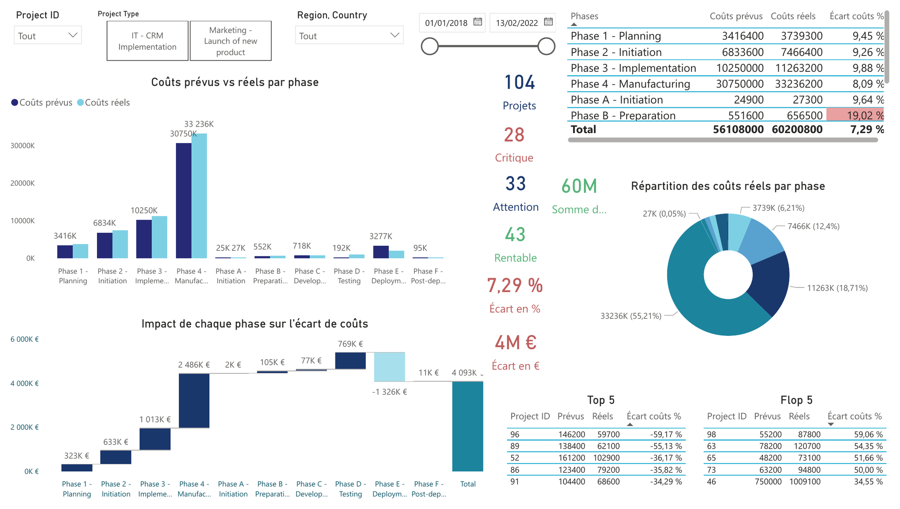

# Is a 7.3% budget overrun under control?

A Power BI dashboard that tracks 104 IT and marketing projects for an oral care company in 52 countries on costs, delays and deliverables, for three levels of directors.

**Read the case study:** https://axeldrtdata.github.io/works/sanitoral-powerbi-dashboard/

## Context

Sanitoral, an international oral care company, ran a portfolio of 104 IT and marketing projects across 4 regions with no shared way to see which ones were drifting. Its Project Management Office tracks every project on three indicators, cost, time and deliverables, and a gap of 15% or more between plan and reality must alert the directors. The dashboard serves three levels of users: the CEO (whole portfolio), regional directors (their zone) and country directors (their projects).

## The dashboard



| Page | What it answers |
| ---- | --------------- |
| Home | The portfolio at a glance, with a button to each page |
| Costs | Planned against actual cost by phase, gap in % and in euros, waterfall of the gap by phase, critical / to watch / under budget counts, five best and five worst projects |
| Delays | Planned against actual duration by phase (dual-line chart), scatter of every project, treemap of the phases running late, question-and-answer box |
| Deliverables | Delivery rate gauge, planned against actual by phase, matrix by region, top 10 countries under-delivering |
| Map | One world map that switches between the three indicators |
| Canvas, Data model | The user stories and the model, for reference |

Slicers (project, type, region, country, period) are synced across pages, Row-Level Security limits each director to their scope, and the question-and-answer box understands French and English synonyms.

## Key results

| Question | Result |
| -------- | ------ |
| Overall cost gap | +7.29%, under the 15% alert, but €4.09M over a €56.1M plan |
| Projects by cost status | 28 critical (15% or more), 33 to watch, 43 under budget |
| Where the overrun comes from | Central and Eastern Europe, Middle East and Africa: 56 projects, +€2.46M (60% of the overrun), 18 of the 28 critical projects. Marketing: +€4.46M; IT: −€0.36M |
| Delays | 8 critical, 16 slightly late, 80 ahead of plan |
| Deliverables | 89.5% of planned deliverables delivered; 9 critical, 94 slightly under, 1 complete |

### Beyond the percentages

**IT's good health sits in a single phase.** Overall, IT projects cost €362,000 less than planned. But the waterfall chart on the Costs page shows where that result comes from: Testing cost €769,000 more than planned, and Deployment, €1.3M under its budget, makes up for it. Even the five most profitable projects of the Top 5 overran on Testing. Either the Testing budget is underestimated from the start, or an operational problem keeps recurring in that phase.

## Repository structure

```
sanitoral-powerbi-dashboard/
├── dashboard/
│   └── sanitoral_powerbi_dashboard.pbix
├── data/                             # the seven tables of the model, exported as CSV
│   ├── Projects_plans.csv            # plan: one row per project and phase (520)
│   ├── Actual_Costs.csv
│   ├── Actual_Duration.csv
│   ├── Actual_Delivrable.csv
│   ├── Project_type.csv
│   ├── Projects_Locations.csv
│   └── Country_Profiles.csv
├── docs/
│   ├── dax-measures.md               # the 22 measures, explained
│   ├── data-model.md                 # relationships, composite key, Row-Level Security
│   └── user-stories.md               # the Product Strategy Canvas
├── images/
└── README.md
```

## How to open it

The dashboard needs Power BI Desktop (Windows). Open `dashboard/sanitoral_powerbi_dashboard.pbix`: the data is imported in the file, so it opens without the source workbook. To point it to a new workbook with the same sheets: *Transform data → Data source settings → Change source*, then *Close & Apply*.

## Limits

- The data is a realistic training case provided by OpenClassrooms, not the books of a real company.
- The map shows an average per country, weighted by budget or duration: a country can look green while hiding a critical project.
- All relationships filter both ways, so that every slicer updates the others; on a larger model, the dimensions would stay one-way.
- Power BI cannot be published openly without a work account, so the dashboard is shown through screenshots.

## Stack

Power BI · DAX · Power Query · Excel

## Data sources

One Excel workbook provided by OpenClassrooms for the Data Analyst path: project plans by phase, actual costs, durations and deliverables, project types, locations and country profiles.

## Note on the language

This project was built in French in April 2026 as part of my OpenClassrooms Data Analyst training. The report, its measures and the source data stay in French; this README and the documentation were written in English for my portfolio in October 2026.

---

Axel Derobert · Data Analyst · Lyon · [Portfolio](https://axeldrtdata.github.io) · [LinkedIn](https://www.linkedin.com/in/axel-derobert-5717463b1/)
